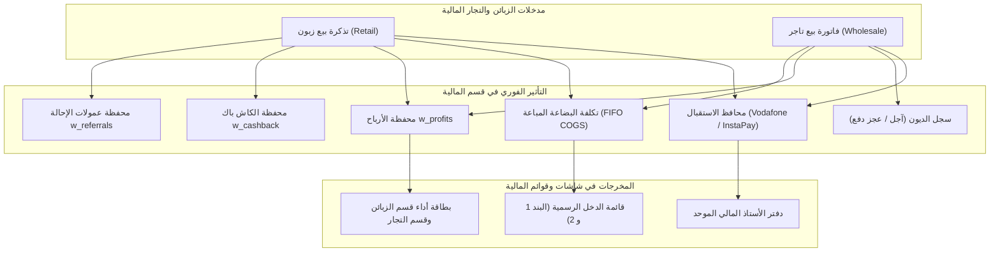

# 💼 التقرير المالي المخصص: قسم الزبائن وقسم التجار داخل النظام المالي
**تحليل تفصيلي شامل لدورة أموال ومحاسبة الزبائن (المفرق) والتجار (الجملة) داخل قسم المالية**

---

## 📑 فهرس التقرير
1. [نظرة عامة ودور الزبائن والتجار في المالية](#1-نظرة-عامة-ودور-الزبائن-والتجار-في-المالية)
2. [المؤشرات المالية الحيوية للزبائن والتجار (KPIs & Metrics)](#2-المؤشرات-المالية-الحيوية-للزبائن-والتجار)
3. [دفتر الأستاذ العام وسجل الحركات الموحد (General Ledger Integration)](#3-دفتر-الأستاذ-العام-وسجل-الحركات-الموحد)
4. [محافظ الاستقبال وقنوات الدفع للزبائن والتجار (Receiving Wallets)](#4-محافظ-الاستقبال-وقنوات-الدفع-للزبائن-والتجار)
5. [إدارة ديون ومستحقات الزبائن والتجار (Debts & Credit Balances)](#5-إدارة-ديون-ومستحقات-الزبائن-والتجار)
6. [التزامات الكاش باك وعمولات الإحالة (Cashback & Referral Reserves)](#6-التزامات-الكاش-باك-وعمولات-الإحالة)
7. [تقفيل الورديات الخاص بتذاكر الزبائن والتجار (Shift Reconciliation)](#7-تقفيل-الورديات-الخاص-بتذاكر-الزبائن-والتجار)
8. [الأثر المالي لمشاكل التذاكر والاحتيال للزبائن والتجار (Problems & Fraud)](#8-الأثر-المالي-لمشاكل-التذاكر-والاحتيال-للزبائن-والتجار)
9. [موقع الزبائن والتجار في قائمة الدخل والتقارير المعتمدة (P&L Position)](#9-موقع-الزبائن-والتجار-في-قائمة-الدخل-والتقارير-المعتمدة)

---

## 1. نظرة عامة ودور الزبائن والتجار في المالية

في قسم المالية، يمثل الزبائن والتجار **المصدر الأساسي والأكبر للتدفقات النقدية الداخلة (Operating Cash Inflow)**. لا يتعامل النظام المالي مع الزبون أو التاجر كاسم مجرد، بل كـ **مركز مالي متكامل** له:
- تدفق نقدي وارد (إيرادات مبيعات الشحن وفواتير الجملة).
- تكلفة بضاعة مباشرة خارجة (COGS) مخصومة وفق سعر الشراء الفعلي بنظام FIFO.
- التزامات مؤجلة (كاش باك مستحق، عمولات إحالة لشركاء النجاح).
- حسابات مدينة ودائنة (ديون، فوارق دفع، وأرصدة سحب آجل).

---

## 2. المؤشرات المالية الحيوية للزبائن والتجار

داخل شاشة `FinanceOverview.tsx` وقاعدة البيانات `db.getFinanceMetrics()`، يتم حساب وفصل الأرقام الخاصة بالزبائن عن التجار كالتالي:

### أ. قطاع الزبائن والشحن المباشر (Retail Customers Metrics):
- **إيرادات الزبائن (`customerRevenue`)**: إجمالي المبالغ المستلمة فعلياً من تذاكر بيع وشحن الزبائن المكتملة.
- **تكلفة بضاعة الزبائن (`customerCost`)**: التكلفة المباشرة للسلع والألعاب المسحوبة من محافظ البضاعة وفق سعر الدولار الحقيقي لسند الشراء (FIFO).
- **صافي ربح الزبائن (`customerProfit`)**: $\text{الإيراد} - \text{تكلفة البضاعة المباشرة}$.
- **عدد عمليات الزبائن (`customerTxCount`)**: إجمالي عدد التذاكر المكتملة للزبائن.
- **مستردات الزبائن (`customerRefunds`)**: إجمالي المبالغ المعادة للزبائن في التذاكر الملغاة أو المستردة.
- **خصومات الزبائن (`customerDiscounts`)**: إجمالي الخصم الممنوح (كوبونات الخصم + الكاش باك المستخدم + رصيد الإحالات المستخدم).
- **كاش باك الزبائن الممنوح (`customerCashback`)**: قيمة الكاش باك المكتسب المودع في محافظ الزبائن.

### ب. قطاع التجار والموزعين (Wholesale Dealers Metrics):
- **إيرادات مبيعات التجار (`dealerRevenue`)**: مجموع فواتير البيع والتوريدات الصادرة لعملاء الجملة والموزعين.
- **تكلفة توريدات التجار (`dealerCost`)**: تكلفة المشتريات وتكاليف البضاعة الموردة للتاجر.
- **صافي أرباح التجار (`dealerProfit`)**: هامش الربح المحقق من تعاملات الجملة (متوسط 10% - 15%).
- **عدد معاملات التجار (`dealerTxCount`)**: عدد الفواتير والتوريدات المعتمدة للتجار.

### جـ. بطاقات أداء الأقسام (Department Breakdown Cards):
في أعلى قسم المالية، توجد بطاقتان مخصصتان:
1. **بطاقة قسم الزبائن**: تعرض إيراد الزبائن، صافي الربح، و**نسبة مساهمة الزبائن في إجمالي أرباح المنشأة**.
2. **بطاقة قسم التجار**: تعرض حجم مبيعات الجملة، الربح الصافي، و**نسبة مساهمة التجار في إجمالي أرباح المنشأة**.

---

## 3. دفتر الأستاذ العام وسجل الحركات الموحد (General Ledger Integration)

في جدول الحركات المالي الموحد `UnifiedFinancialTransaction`:
- **تصنيف القسم**:
  - `customers`: تظهر بوسم مميز **"قسم الزبائن (شحن مباشر)"**.
  - `dealers`: تظهر بوسم مميز **"قسم التجار (مبيعات الجملة)"**.
- **بيانات الطرف والعميل**:
  - اسم الزبون أو التاجر (`partyName`).
  - رقم الهاتف (`partyPhone`).
  - نوع الطرف: `customer` أو `dealer`.
- **البيانات المالية للسطر**:
  - المبلغ المسدد (`amount`).
  - تكلفة البضاعة المستهلكة للطلب (`costAmount`).
  - صافي الربح الناتج عن الحركة (`netProfit`).
  - المحفظة المستخدمة في السداد (`walletName`).
  - رقم التذكرة أو الفاتورة المرجعية (`referenceNumber`).
  - اسم الموظف المنفذ (`performedBy`).

---

## 4. محافظ الاستقبال وقنوات الدفع للزبائن والتجار

- **ربط محافظ الاستقبال بالتذاكر**:
  - عند قيام زبون أو تاجر بالدفع، يسجل النظام اسم المحفظة المستلمة (فودافون كاش، إنستاباي، البنك الأهلي، إلخ).
  - يُحدد **الرقم/الخط الفرعي** الذي استقبل المبلغ من داخل المحفظة.
  - يُخصم تلقائياً من **الحد الشهري واليومي للاستقبال** على هذا الخط، لمنع حظر خطوط المحافظ.
- **بيانات التحويل المسجلة بالمالية**:
  - رقم هاتف العميل/التاجر المحول منه (`senderPhoneNumber`).
  - الرقم المرجعي للحوالة البنكية أو كود عملية فودافون كاش (`transferReferenceNumber`).

---

## 5. إدارة ديون ومستحقات الزبائن والتجار (Finance Debts)

في تبويب **"الديون والمستحقات" (`FinanceDebts.tsx`)**:

### أ. ديون وحسابات الزبائن (Customer Debts):
1. **الرصيد المدين (ديون لنا طرف الزبون)**:
   - ينشأ إذا قام الزبون بدفع مبلغ أقل من المطلوب في التذكرة (`shortageAmount`).
   - يُسجل تلقائياً كدين في قسم الديون ونوع الطرف `customer`.
2. **الرصيد الدائن (مستحقات للزبون طرفنا)**:
   - ينشأ إذا حوّل الزبون مبلغاً زائداً عن سعر التذكرة (`overpaymentAmount`).
   - يُضاف في رصيد حساب الزبون الدائن لاستخدامه في تسوية تذاكر قادمة.

### ب. ديون وحسابات التجار (Dealer & Wholesale Debts):
1. **حسابات البيع الآجل للجملة (ديون لنا - Receivables)**:
   - فواتير بضاعة تم تسليمها للتاجر على الحساب.
   - سقف المديونية الائتماني (Credit Limit) لكل تاجر لضمان عدم تجاوز الحد المسموح.
   - تتبع مواعيد الاستحقاق وحالات التأخير.
2. **نظام الأقساط والتحصيل الجزئي للتجار**:
   - تسجيل دفعات السداد الجزئية مع توثيق اسم المحصل ورقم الإيصال.
   - خصم المسدد من رصيد مديونية التاجر فورياً.
3. **أرصدة التجار الدائنة (ديون علينا - Payables)**:
   - مبالغ محولة مسبقاً من التاجر تحت حساب طلبيات قادمة.

---

## 6. التزامات الكاش باك وعمولات الإحالة (Cashback & Referral Reserves)

في تبويب **"العمولات والكاش باك" (`FinanceCommissions.tsx`)**:

### أ. التزام كاش باك الزبائن (`w_cashback`):
- يمثل مجموع أرصدة الكاش باك المسجلة في محافظ الزبائن.
- **الأثر المالي**:
  - عند إكمال تذكرة زبون مستحقة لكاش باك: يُضاف المبلغ لمحفظة العميل ومحفظة النظام `w_cashback`.
  - عند استخدام الكاش باك في شراء تذكرة: يُخصم المبلغ من فاتورة العميل ويُخصم من المحفظة.
  - عند استرداد التذكرة: يُعكس الكاش باك الممنوح فورياً.

### ب. التزام عمولات شركاء النجاح (`w_referrals`):
- كل عميل محال من شريك أو مسوق يشتري تذكرة، تُحسب عمولة الشريك بنسبة مئوية.
- تُضاف العمولة لمحفظة الشريك وتُسجل في محفظة النظام `w_referrals`.
- عند طلب المسوق سحب أرباحه، يُصرف المبلغ من الخزينة أو محفظة كاش ويُقيد كمصروف عمولات مسوقين.

---

## 7. تقفيل الورديات الخاص بتذاكر الزبائن والتجار (Shift Reconciliation)

في نافذة تقفيل الوردية `ShiftSettlementModal.tsx` وسجل الورديات `FinanceSettlements.tsx`:
- **فلتر الأقسام بالوردية (`selectedDeptFilter`)**:
  - إمكانية تقفيل وجرد الوردية لـ **قسم الزبائن فقط** أو **قسم التجار فقط** أو كليهما.
- **مطابقة مبيعات التذاكر**:
  - جرد النقدية المتوقعة من تذاكر الزبائن والتجار المنفذة خلال ساعات الشفت.
  - حصر مبيعات كل كاشير ومسؤول شحن.
  - رصد أي عجز في تذاكر الشحن واقتطاعه من مسؤولية الموظف أو تسجيله كعجز وردية معتمد.

---

## 8. الأثر المالي لمشاكل التذاكر والاحتيال للزبائن والتجار

وفقاً للتحديث المعتمد:

| الحالة في تذاكر الزبائن أو التجار | الأثر المالي على محفظة البضاعة | الأثر المالي على محفظة التشغيل |
|---|---|---|
| **مشكلة 1: وصل منتج مختلف بنفس السعر** | تسوية وتعديل المخزون دون تغيير مالي لتساوي السعر | لا يوجد أثر نقدي (إلا إذا اختار المالك استرداداً فيُصرف من محفظة التشغيل) |
| **مشكلة 2: شحن لحساب غلط / مبلغ غلط** | تسجيل قيد عجز وخسارة تكلفة البضاعة المفقودة على عهدة الطرف المتحمل | في حال الاسترداد: يُخصم المبلغ الفعلي المستلم من محفظة التشغيل المحددة |
| **حالة الاحتيال (تفعيل المالك)** | تُخصم تكلفة المنتج فوراً من محفظة البضاعة وتسجل كحركة خسارة (`loss`) | تُستبعد مبالغ التذكرة من دخل التشغيل، وتُعكس الأرباح من محفظة `w_profits` |
| **استرداد تذكرة احتيال** | **رصيد البضاعة يرجع** للمحفظة فورياً | **المبلغ الفعلي يُخصم** من محفظة التشغيل |

---

## 9. موقع الزبائن والتجار في قائمة الدخل والتقارير المعتمدة (P&L Position)

في شاشة **"التقارير المالية المعتمدة" (`FinanceReports.tsx`)**:

### أ. البند الأول في قائمة الدخل الرسمية (Revenues):
$$\text{إجمالي الإيرادات} = \underbrace{\text{مبيعات شحن الزبائن}}_{\text{Customer Revenue}} + \underbrace{\text{مبيعات وفواتير التجار}}_{\text{Dealer Revenue}} + \text{باقي الأقسام}$$

### ب. البند الثاني (تكلفة البضاعة المباشرة COGS):
- تكلفة بضاعة تذاكر الزبائن المشحونة (FIFO).
- تكلفة بضاعة فواتير التجار الموردة (FIFO).

### جـ. التقارير المستقلة المخصصة للطباعة وتصدير Excel:
1. **تقرير مبيعات وأرباح الشحن (Customer Top-Up & Sales Report)**:
   - حركات شراء الزبائن، أسماء الألعاب الأكثر طلباً، ومتوسط هوامش أرباح التذاكر.
2. **تقرير فواتير وحسابات التجار (Wholesale & Dealers Accounts Report)**:
   - كشف حساب لكل تاجر، فواتير الشراء والبيع، الأرصدة المدينة والدائنة، ومعدلات السداد.

---

## 📌 خلاصة التقرير
حسابات **الزبائن والتجار** في قسم المالية تشكل **أكثر من 80% من النشاط المالي للنظام**:
1. مبيعات التذاكر تتدفق آلياً لمحفظة الاستقبال المحددة وتخصم من حدود خطوطها.
2. التكلفة تُسحب لحظياً من مخزون البضاعة الفعلي بحساب FIFO لضمان ربحية دقيقة.
3. التزامات الكاش باك والعمولات والديون تُضبط بمحافظ نظام آلية تمنع أي اختلال دفتري.
4. التقارير وقوائم الدخل تفصل إيرادات وأرباح الزبائن عن التجار بنقرة زر واحدة.
